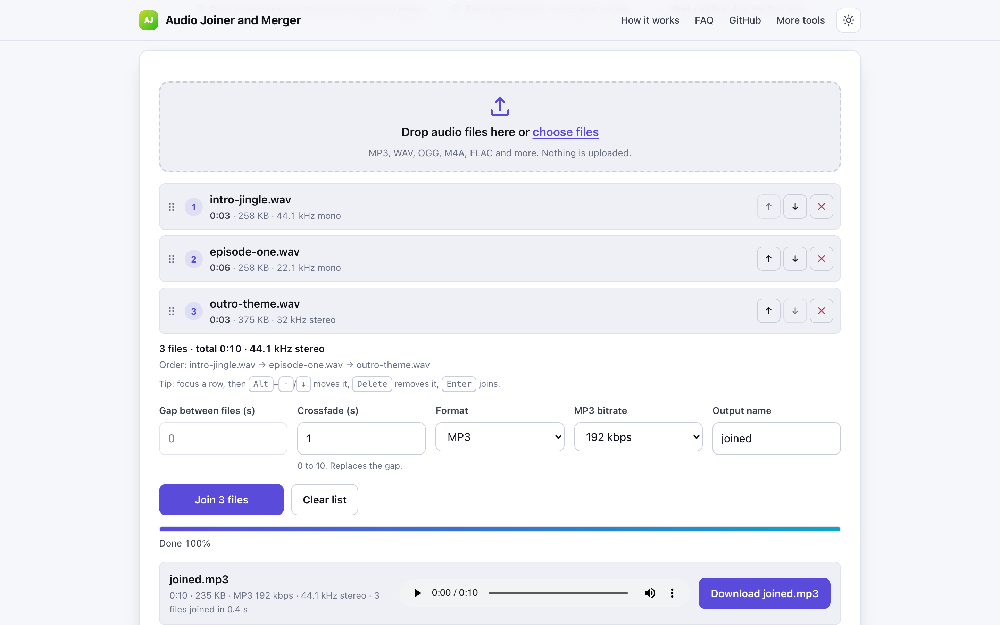
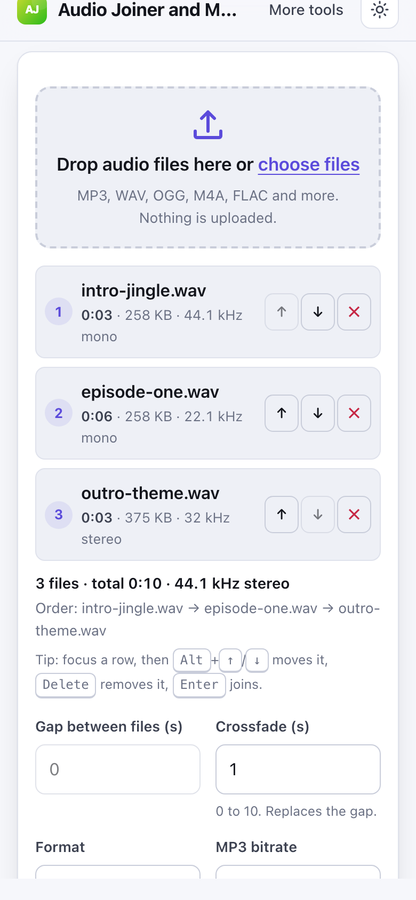

# Audio Joiner and Merger

> Join several audio files into one MP3 or WAV in your browser with drag to reorder and crossfade.

**🌐 Use it now: [turhe123.github.io/audio-joiner-merge](https://turhe123.github.io/audio-joiner-merge/)** · free · open source · runs in your browser · works offline


## Why

This is a free, open-source alternative to Audio Joiner at 123apps, which is ad supported, uploads files for processing on some flows, has limits on formats and sizes, and nags for the paid app. Here your files never leave the device, there is no account, no ads and no artificial limits, it works offline, and it can be installed as an app.

## Screenshots

<p align="center"></p>

<p align="center"><em>Audio Joiner and Merger in the browser, light theme</em></p>

<p align="center"></p>

<p align="center"><em>Audio Joiner and Merger on a phone</em></p>

## Features

- Add many files at once by drag and drop (anywhere on the page) or with the file picker.
- Each row shows name, duration, size, sample rate and mono or stereo; duplicate names are flagged.
- Reorder by dragging rows or with the up and down buttons; remove single rows or clear the list.
- Keyboard control: with a row focused, Alt+Up/Down moves it, Delete removes it, Enter joins; Up/Down moves focus.
- Optional silent gap between files (0 to 60 seconds, default 0).
- Optional crossfade between consecutive files (0 to 10 seconds, default 0) using linear fades; a crossfade replaces the gap.
- Total duration and the file order are shown before you join.
- Output as MP3 (96, 128, 160, 192, 256 or 320 kbps; default 192) or 16-bit WAV.
- Output sample rate follows the first file; other files are resampled. Mono sources are mixed into both channels of a stereo result.
- MP3 and WAV encoding runs in a Web Worker, with a visible percentage progress bar.
- Result card with duration, size, a built-in audio player and a download button; the output name is editable (default `joined`).
- A file that cannot be decoded is marked on its own row and skipped; non-audio files are rejected with a visible message.
- Light and dark themes, responsive down to 390px wide.

**Input formats:** whatever your browser can decode, typically MP3, WAV, OGG/Opus, AAC/M4A, FLAC, WebM and AIFF. Some M4A or FLAC files may not decode in every browser.

**Output formats:** MP3 or WAV.

**Limits:**

- About 2 hours of total decoded audio, because everything is held in memory.
- No loudness normalization is applied; clips with very different volumes stay that way.
- Crossfades are clamped to the length of the clips involved.
- MP3 output uses the nearest MP3-supported sample rate to the first file's rate, and bitrates are capped at 160 kbps below 32 kHz.

## How to use

1. Drop audio files onto the page or choose them with the picker.
2. Put them in the order you want by dragging rows or using the arrow buttons.
3. Set a gap or crossfade, pick MP3 or WAV, and edit the output name if you like.
4. Press **Join**, listen to the preview, then press **Download**.

## Privacy

- Nothing is uploaded. Files are decoded, joined and encoded on your device.
- No cookies.
- Page views are counted anonymously with [GoatCounter](https://www.goatcounter.com/), which is cookieless and open source.
- Works offline after the first visit thanks to a service worker.

## Run it locally

```sh
git clone https://github.com/turhe123/audio-joiner-merge
cd audio-joiner-merge
python3 -m http.server 4173
```

Then open http://127.0.0.1:4173/. There is no build step.

## Tests

```sh
npm i -D @playwright/test && npx playwright install chromium
npx playwright test
```

## Third-party code

- [lamejs](https://github.com/zhuker/lamejs) 1.2.1, LGPL-3.0, in `vendor/lamejs/` (MP3 encoding).

## Built with AI

Audio Joiner and Merger was written by [Claude Code](https://claude.com/claude-code) inside an automated pipeline, from a plain-English spec. No code or assets from any commercial product were used; it is a clean-room implementation of a feature set, not a copy.

What that means in practice:

- The full source is in this repo under the MIT license. Read it before you trust it with your files.
- Everything runs in your browser. It makes no network requests except an anonymous, cookieless page-view count (GoatCounter); your files never leave the device.
- The page is tested headless in Chromium (Playwright) before every release, but it has had less human review than hand-written software. Bug reports and pull requests are welcome.

## Support ❤️

If this saved you time, you can support the project on [Ko-fi](https://ko-fi.com/leodavidai).

## More free web tools

See the rest at [turhe123.github.io/web-tools](https://turhe123.github.io/web-tools/).

## License

MIT © Or Davidai Bachar
